<!-- Handcrafted SVGs, CSS/SMIL only. No Actions, scripts, fonts or remote assets inside the artwork. -->

<a href="https://1commercesolutions.com/">
<picture>
  <source media="(max-width: 600px)" srcset="./assets/os-identity-mobile.svg">
  
</picture>
</a>

# Keith J. Skaggs · 1COMMERCE

I turn business ideas into websites, storefronts and connected systems. Founder of **1Commerce LLC**, based in the Pacific Northwest — designing, building and maintaining the whole thing.

**Websites & apps** · **E-commerce** · **AI & automation** · **Hosting & ongoing care**

[Start a project](mailto:skdev@1commerce.online) · [Client work](#client-work) · [Projects](#projects) · [Research lab](#research-lab) · [Connect](#connect)

## Client work

Four businesses. Four different briefs. Websites and storefronts I designed, built and deployed.

*Animated illustrations of the work. Select a card to open the live site.*

<!-- client work: real, live, public sites -->

<a href="https://tobereadshop.com"></a>
<a href="https://precisioncorebuilders.com"></a>

<a href="https://montuckymoonshine.com"></a>
<a href="https://windowsbyclearview.com"></a>

[To Be Read](https://tobereadshop.com) · [Precision Core Builders](https://precisioncorebuilders.com) · [Montucky Moonshine](https://montuckymoonshine.com) · [ClearView Windows and Trim](https://windowsbyclearview.com)

## Projects

### The Walking Dead Universe Atlas

<a href="https://walking-dead-universe-atlas.vercel.app/">
<picture>
  <source media="(max-width: 600px)" srcset="./assets/project-atlas-mobile.svg">
  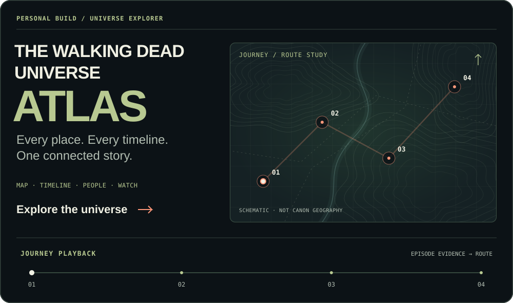
</picture>
</a>

A connected guide to **places, timelines, people and what to watch**. Follow journeys through episode evidence, compare up to three routes, and explore with spoiler-aware playback.

[**Explore the atlas ↗**](https://walking-dead-universe-atlas.vercel.app/) · [View the code](https://github.com/ksksrbiz-arch/walking-dead-universe-atlas)

<a href="https://walking-dead-universe-atlas.vercel.app/">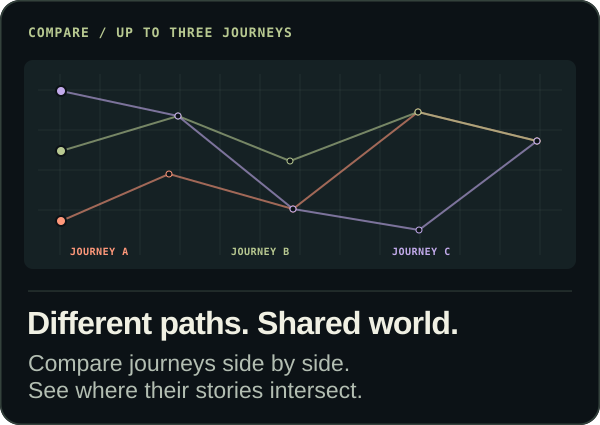</a>
<a href="https://walking-dead-universe-atlas.vercel.app/">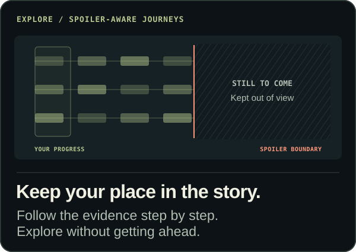</a>

**React · TypeScript · Vite · Vercel** — structured JSON registries, global search and shareable links.

*The animations illustrate features; routes and geography are schematic. Reduced-motion preferences show static compositions.*

### Commerce platforms & agent tooling

Building **UnifyOne**, the **Cathedral Framework**, and **MCP tools** that connect business systems with AI.

**Platform previews** — illustrative animations with sample data, not live revenue or performance telemetry.

<!-- platform & tooling I build and run myself -->

<a href="https://github.com/t7451/unifyone-netlify-supabase"></a><a href="https://github.com/ksksrbiz-arch/onecommerce-mcp-server"></a>

## Inside 1COMMERCE OS

This profile is also a small operating system: hand-built animated SVGs, simulated desktop sessions, an editor, and a repo file manager. Open a window and look around.

<b>Boot the desktop</b> — three sessions, a terminal, client ops and source code

*Illustrative desktop sessions; order totals and performance figures are sample data.*

<!-- menu bar -->

<a href="mailto:skdev@1commerce.online">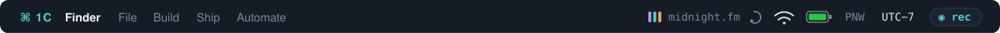</a>

<!-- boot sequence → desktop -->

<!-- terminal + client ops panel -->


<!-- services: what the business actually sells -->

<a href="mailto:skdev@1commerce.online">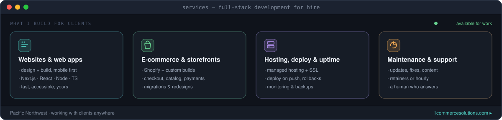</a>

<!-- editor: real source from the Cathedral Framework -->


Hosting &amp; delivery — infrastructure, process and contact

<!-- managed hosting status board (generated by tools/gen_status_board.py) -->

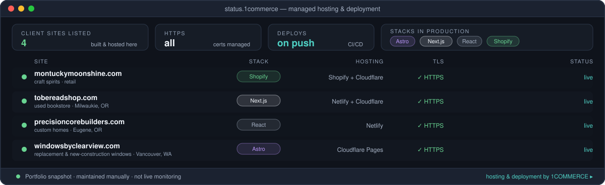

<!-- deploy pipeline set piece -->


<!-- how a project runs -->


<!-- start a project — the conversion point -->

<a href="mailto:skdev@1commerce.online"></a>

<b>Open the file manager</b> — repositories and side quests

<!-- ~/repos file manager (generated by tools/gen_repo_windows.py) -->
<!-- REPO-WINDOWS:START -->

<a href="https://github.com/ksksrbiz-arch?tab=repositories"></a>

<!-- REPO-WINDOWS:END -->

<!-- side quests: personal projects, kept clearly apart from client work -->

<a href="https://github.com/ksksrbiz-arch?tab=repositories">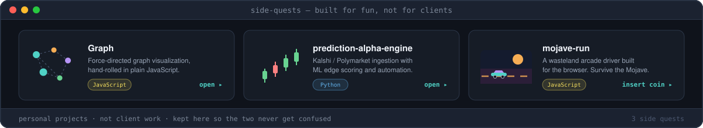</a>

## Research lab

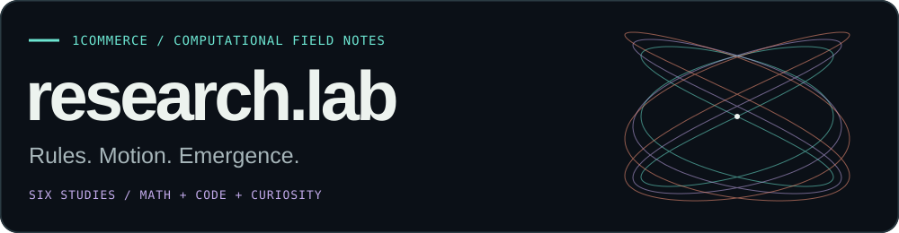

Six experiments in how simple rules produce complex behavior. **Computed in Python. Replayed as SVG.** Open any study for a closer look.

<a href="./assets/lab-study-chaos.svg">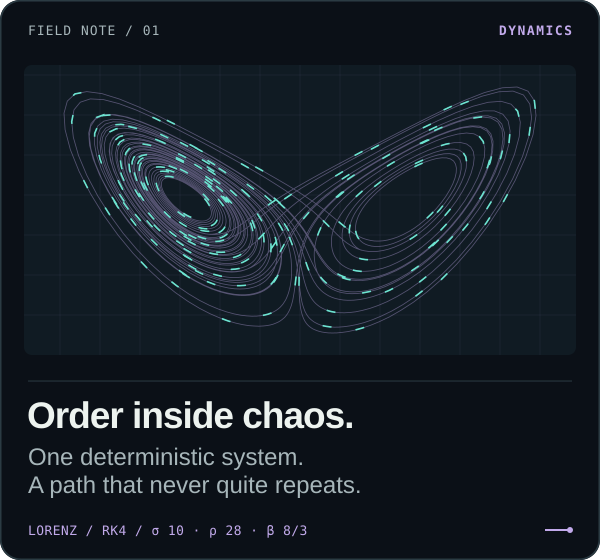</a>
<a href="./assets/lab-study-life.svg"></a>

<a href="./assets/lab-study-globe.svg">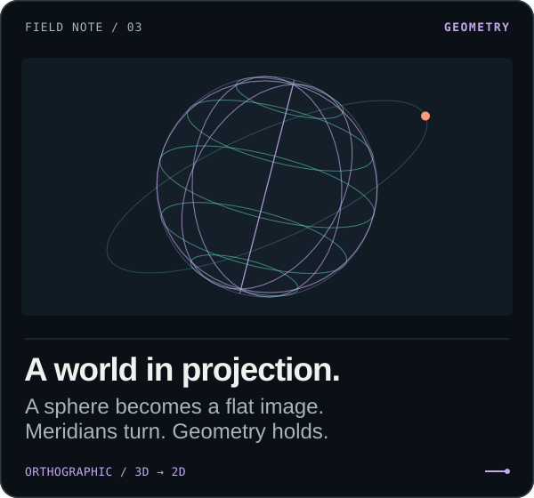</a>
<a href="./assets/lab-study-physics.svg">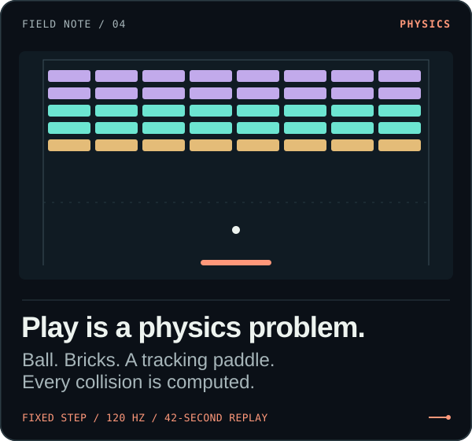</a>

<a href="./assets/lab-study-terrain.svg">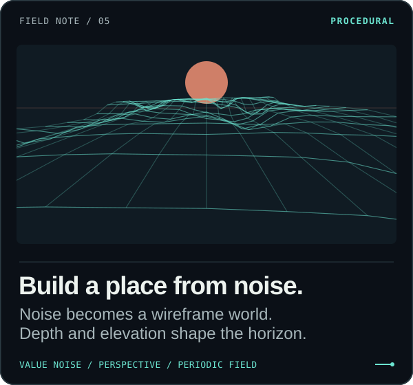</a>
<a href="./assets/lab-study-signals.svg"></a>

[Inspect the generator](./tools/gen_research_lab.py) · [Lorenz](./assets/lab-study-chaos.svg) · [Life](./assets/lab-study-life.svg) · [Globe](./assets/lab-study-globe.svg) · [Breakout](./assets/lab-study-physics.svg) · [Terrain](./assets/lab-study-terrain.svg) · [Signals](./assets/lab-study-signals.svg)

<b>Field notes</b> — the methods behind the motion

| Study | What the code does |
| --- | --- |
| **01 · Lorenz** | Integrates the Lorenz equations with RK4, using σ = 10, ρ = 28, β = 8/3 and a 0.006 time step. Projects the x/z trajectory. |
| **02 · Life** | Applies B3/S23 to a Gosper glider gun for 120 generations on a finite 48 × 27 grid. Cells outside the grid are dead. |
| **03 · Globe** | Rotates spherical coordinates, applies tilt and roll, then projects them orthographically. The orbit is a geometric illustration. |
| **04 · Breakout** | Steps the simulation at 120 Hz, detects circle/rectangle collisions and moves a paddle with bounded tracking speed. Replays 42 seconds at 20 sampled positions per second. |
| **05 · Terrain** | Interpolates a deterministic, periodic value-noise field and projects its elevations in perspective. The field loops continuously. |
| **06 · Signals** | Choreographs pulses through a 4 → 6 → 6 → 1 graph. Illustrates signal propagation; no training, learned weights or inference. |

The new studies include separate static compositions for **reduced-motion** preferences. Each SVG is self-contained: no JavaScript, external fonts or live data. The generator checks Life oscillators, projection bounds, finite Lorenz values, periodic noise and the Breakout arena before writing any artwork.

Regenerate with `python3 tools/gen_research_lab.py`, or run only the checks with `python3 tools/gen_research_lab.py --check`.

<b>Original experiment archive</b> — the first OS windows and cellular screensaver

The original animated experiments remain intact:

[chaos.app](./assets/lab-lorenz.svg) · [life.app](./assets/lab-life.svg) · [hologram.app](./assets/lab-hologram.svg) · [arcade.app](./assets/lab-breakout.svg) · [terrain.app](./assets/lab-terrain.svg) · [cortex.app](./assets/lab-cortex.svg) · [Matrix divider](./assets/os-rain.svg)


<!-- dock: tech stack -->

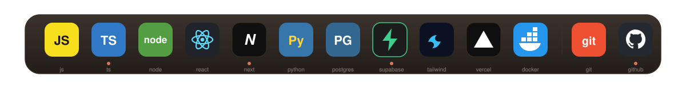

<!-- Optional server-rendered statistics; no Actions required. -->
[GitHub activity](https://github.com/ksksrbiz-arch?tab=overview) · [Streak statistics](https://streak-stats.demolab.com?user=ksksrbiz-arch)

## Connect

[Email](mailto:skdev@1commerce.online) · [Website](https://1commercesolutions.com) · [Shop](https://shop.1commercesolutions.com) · [LinkedIn](https://www.linkedin.com/in/1commerce-future/) · [YouTube](https://www.youtube.com/@0nestakk) · [Instagram](https://www.instagram.com/1commerce_llc/)

Contact card

<!-- connect -->

<a href="mailto:skdev@1commerce.online">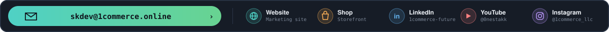</a>

<!-- shutdown / call to action -->

[Follow on GitHub](https://github.com/ksksrbiz-arch?tab=followers)

🖥️ Plain-text mode (for humans without pixels &amp; robots without eyes)

### About

**1COMMERCE — full-stack development for hire.** I design, build, deploy and
host websites, web apps and storefronts for clients, and I keep them running
afterwards. Side projects and experiments live further down the page.

**Services**

| | |
| --- | --- |
| **Websites & web apps** | Design and build, mobile first — Next.js · React · Node · TypeScript |
| **E-commerce & storefronts** | Shopify and custom builds, migrations and redesigns |
| **Hosting, deploy & uptime** | Managed hosting, SSL, deploy-on-push, monitoring and backups |
| **Maintenance & support** | Updates, fixes and content — retainer or hourly |

Pacific Northwest · working with clients anywhere · [1commercesolutions.com](https://1commercesolutions.com)

- 🔭 Building **1COMMERCE / UnifyOne** and the Cathedral Framework
- 🌐 Shipping and hosting **client sites, storefronts and web apps**
- ⚙️ Designing **MCP servers** & agentic tooling
- 🧰 Full-stack in **TypeScript** (Next.js · Node · Supabase) + **Python**
- 🤖 Pair-programming with **Claude Code** every day
- 🌐 [1commercesolutions.com](https://1commercesolutions.com) · 🛍️ [shop.1commercesolutions.com](https://shop.1commercesolutions.com)
- 🌲 Pacific Northwest · Pacific time

### Client work

| Site | What it is | Stack |
| --- | --- | --- |
| [tobereadshop.com](https://tobereadshop.com) | **To Be Read** — used bookstore & book exchange, Milwaukie OR | Next.js |
| [precisioncorebuilders.com](https://precisioncorebuilders.com) | **Precision Core Builders** — custom homes & remodeling, Eugene OR (CCB #246527) | React |
| [montuckymoonshine.com](https://montuckymoonshine.com) | **Montucky Moonshine** — craft spirits storefront | Shopify |
| [windowsbyclearview.com](https://windowsbyclearview.com) | **Clearview Windows** — replacement & new-construction windows, Vancouver WA ([repo](https://github.com/ksksrbiz-arch/windowsbyclearveiw)) | Astro |

All four are designed, built, deployed and hosted by 1COMMERCE.

### Platform & side projects

| Project | What it is |
| --- | --- |
| [unifyone-netlify-supabase](https://github.com/t7451/unifyone-netlify-supabase) | Multi-tenant commerce SaaS on Netlify + Supabase — the flagship |
| [onecommerce-mcp-server](https://github.com/ksksrbiz-arch/onecommerce-mcp-server) | MCP server: 18 tools across the Cathedral Framework |
| [Graph](https://github.com/ksksrbiz-arch/Graph) | Interactive graph visualization in JavaScript |
| [prediction-alpha-engine](https://github.com/ksksrbiz-arch/prediction-alpha-engine) | Prediction-market alpha engine in Python (Kalshi/Polymarket) |
| [montucky-moonshine-proposal](https://github.com/ksksrbiz-arch/montucky-moonshine-proposal) | Shopify storefront redesign — [live demo](https://montucky-moonshine-proposal.netlify.app) |
| [mojave-run](https://github.com/ksksrbiz-arch/mojave-run) | Wasteland arcade driver for the browser |
| [walking-dead-universe-atlas](https://github.com/ksksrbiz-arch/walking-dead-universe-atlas) | Mobile-first, data-driven atlas for the Walking Dead Universe — [live site](https://walking-dead-universe-atlas.vercel.app/) |

### Hire me

**skdev@1commerce.online** — usually a same-day reply. Helpful to include what
the site needs to do, a rough timeline, a budget range even if loose, and a site
or two you like. No brief yet is fine; we work it out on a free call, then you
get a fixed quote before anything starts. You own the code, the domain and the
accounts.

### How this page works

Every window above — identity, boot screen, terminal, ops panel, client previews, deploy
pipeline, file manager, dock, screensaver, footer — is a **hand-crafted animated
SVG** checked into [`/assets`](./assets). No GitHub Actions required for rendering: the animations are pure CSS/SMIL baked into the files themselves,
themed in **midnight** (dark chrome, cyan primary, violet/amber/green
accents and a warm coral brand color). Local image paths follow the current
branch, so previews and the merged profile use the same artwork.

Highlights:

- **Identity & client showcases** — responsive desktop/mobile identity artwork, animated isometric layers and four art-directed client cards. Generated by [`tools/gen_profile_showcase.py`](./tools/gen_profile_showcase.py); the new artwork respects reduced-motion preferences.

- **Triple boot** — the desktop tour runs a 30s boot (BIOS → splash → desktop) on a
  90s master cycle, and each boot logs into a *different* session: a prod
  deploy, a live order feed, or an arcade break. Sky effects run on co-prime
  periods (7/9/13/14s), so no two loops render identically.
- **`~/repos` file manager** — one Files window listing every repository,
  generated by [`tools/gen_repo_windows.py`](./tools/gen_repo_windows.py)
  with per-language smart folders; it regrows automatically when the script
  runs after a new repo is created.
- **`neofetch`** in the about terminal, complete with palette swatches.
- **The deploy pipeline** — a commit packet travels `git push` → build → CDN
  edge → live over a 10s loop, which is genuinely how every client site ships.
- **The ops panel** lists three managed sites with only verifiable facts —
  stack, hosting and recorded HTTPS status. The hosting board is a manually maintained snapshot; animated platform panels use illustrative data.
- **The hosting status board** is generated by
  [`tools/gen_status_board.py`](./tools/gen_status_board.py) from
  [`tools/clients.json`](./tools/clients.json) — nothing is polled at render
  time, and entries flagged `placeholder` render anonymized.
- **`editor.app`** — real Cathedral Framework source (an MCP tool definition)
  syntax-highlighted in an editor window, with the `run()` body typing itself out.
- **Animated app previews** — each featured-project window shows that project
  through illustrative scenes: a control plane, a tool-call log, a force
  simulation, a market chart, a storefront checkout, an arcade game.

The **original archived Research Lab** windows use computed simulation and geometry:

- `chaos.app` — a real **Lorenz attractor**, numerically integrated with
  RK4 (σ=10, ρ=28, β=8/3, ~2,100 sample points) and baked into the path data.
- `arcade.app` — a **self-playing Breakout**: an 85-second physics
  simulation (wall/paddle/brick collisions, demo-mode aim assist) encoded
  as SMIL keyframes — every bounce is a computed vertex, every brick dies
  at its exact collision time.
- `hologram.app` — a rotating wireframe globe using real **orthographic
  projection**: meridians sweep `rx = R·|sin(φ+ωt)|` while latitudes stay
  invariant under the spin.
- `cortex.app` — a 4×6×6×1 network with signal pulses timed to fire the
  output neuron every forward pass.
- `life.app` — **Conway's Game of Life** (B3/S23): a Gosper glider gun
  simulated for 140 generations; every cell birth and death is a discrete
  SMIL keyframe at its exact generation time.
- `terrain.app` — a **procedural flyover**: value-noise ridgelines flying
  toward the camera on perspective-eased keyframes, 14 rows deep.
- `conway.scr` — the screensaver: the **1COMMERCE wordmark seeded as live
  cells**, held for a beat, then dissolved by B3/S23 over 85 generations —
  632 cells touched, 53 survive.

